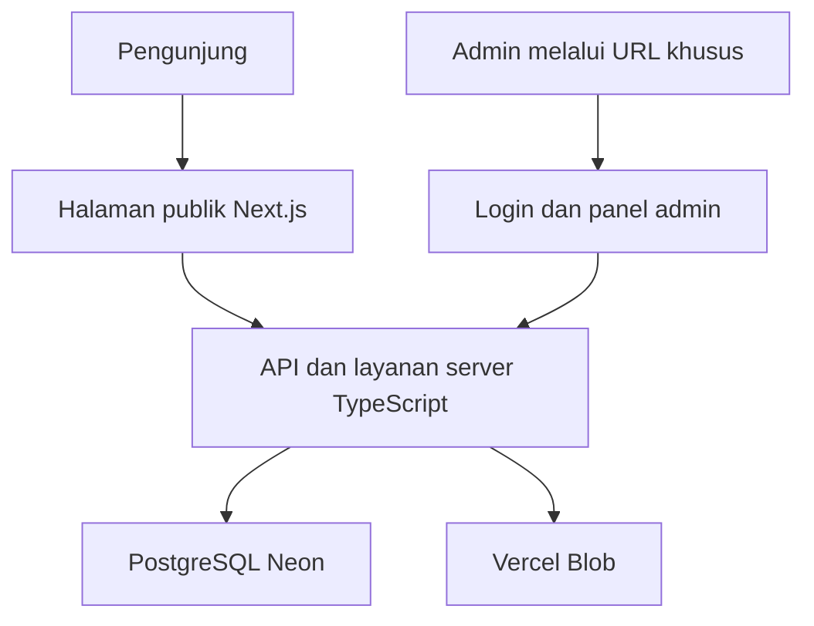

# Arsitektur website PMII

## Status
Stack utama sudah dipilih pengguna. Detail model, API, dan keamanan di bawah merupakan rancangan untuk implementasi. Agent harus menyelaraskannya dengan source asli dan jawaban `OPEN_QUESTIONS.md`. Source belum disertakan dalam paket spesifikasi ini.

## Komponen
| Lapisan | Tanggung jawab |
| --- | --- |
| Next.js publik | Merender seluruh halaman dengan tampilan asli |
| Next.js admin | Login melalui path khusus dan pengelolaan seluruh modul |
| API TypeScript | Validasi, autentikasi, otorisasi, operasi bisnis |
| Layanan server | Aturan domain yang dipakai API dan Server Components |
| PostgreSQL Neon | Konten, peserta, pengaduan, admin, sesi, metadata file |
| Vercel Blob | Aset publik dan berkas pribadi dengan akses yang ditegakkan server |
| Vercel | Menjalankan frontend dan fungsi backend dalam satu proyek |

Frontend dan backend berada pada origin yang sama. Tidak perlu membuat server Express terpisah untuk memenuhi kebutuhan ini. Server Components memanggil layanan server secara langsung, bukan HTTP ke API sendiri.



## Struktur direktori usulan
```text
src/
  app/
    (public)/
      page.tsx
      profil/sejarah/page.tsx
      profil/struktur/page.tsx
      kopri/page.tsx
      galeri/page.tsx
      landasan-hukum/page.tsx
      advokasi/page.tsx
      mapaba/page.tsx
    (admin)/
      [adminPath]/
        login/page.tsx
        (protected)/
          layout.tsx
          page.tsx
          konten/page.tsx
          struktur/page.tsx
          kopri/page.tsx
          galeri/page.tsx
          dokumen/page.tsx
          advokasi/page.tsx
          mapaba/page.tsx
    api/
      public/
      admin/
      auth/
  components/
    public/
    admin/
    shared/
  server/
    auth/
    db/
    repositories/
    services/
    storage/
    security/
  schemas/
  types/
  styles/
scripts/
  provision-admin.ts
  reset-admin.ts
  revoke-admin-sessions.ts
  import-reference-content.ts
tests/
  integration/
  e2e/
reference-original/
docs/
```

Route group `(admin)` tidak menyembunyikan URL. `[adminPath]` harus dicocokkan terhadap konfigurasi server sebelum menampilkan halaman. Path yang tidak cocok menghasilkan 404. Periksa tabrakan dynamic route dengan route publik, API, dan file statis. Jika menggunakan route literal, isinya harus berasal dari keputusan pengguna, bukan tebakan agent.

## Batas data
- Database diakses dari server. Browser tidak memperoleh database password atau service role key.
- Query publik memakai DTO yang hanya memuat konten terbit. Pengaduan, sesi, peserta, KTM, dan pas foto tidak termasuk DTO publik.
- Konten yang dikelola admin berasal dari database. Seed mengimpor data asli satu kali secara idempotent; tidak menimpa edit admin pada setiap build.
- Semua mutasi admin memanggil pemeriksaan sesi dan izin dalam handler/layanan server. Layout atau proxy saja tidak cukup.
- Halaman privat dan respons privat memakai kebijakan tanpa cache publik. Invalidasi konten publik dilakukan setelah transaksi berhasil.

## Alur form
Pengunjung mengisi form. Browser memvalidasi untuk membantu pengguna. Server memvalidasi ulang, menerapkan batas pengiriman, menjalankan transaksi database, dan mengembalikan hasil setelah commit. Browser menampilkan nomor hasil atau error sesuai respons nyata.

MAPABA tidak membuat akun pengguna. File pribadi diunggah langsung ke bucket private memakai otorisasi upload sementara yang terikat pada draft. Server memverifikasi metadata, isi/tipe file, ukuran, kepemilikan draft, dan objek sebelum mengaitkannya ke peserta. Tiket upload anonim hanya mengizinkan path acak tertentu; tidak mengizinkan list atau download bucket.

## Backend pada Vercel
Gunakan runtime Node yang kompatibel dengan database driver dan hashing. Gunakan connection pooling yang sesuai dengan serverless. Jangan memakai memori satu proses untuk sesi atau rate limit lintas instance. Filesystem runtime bukan penyimpanan permanen.

Upload dua berkas MAPABA masing-masing sampai 3 MB dapat melebihi batas body fungsi jika dikirim bersama. Gunakan upload langsung dengan signed authorization, lalu finalisasi metadata melalui API. Jangan meningkatkan batas form secara sembarang untuk mengatasi batas provider.

## Pilihan teknis yang agent perlu dokumentasikan
- ORM/driver, migrasi, dan skema yang dipakai.
- Algoritma password dari pustaka teruji, misalnya Argon2id, atau scrypt dengan parameter yang ditinjau.
- Sesi opaque yang disimpan server-side dengan token acak dan hash token dalam database.
- Validasi schema bersama frontend/backend, misalnya Zod.
- Implementasi rate limit persisten. Privasi referensi melarang penyimpanan IP mentah oleh aplikasi; jangan menambahkan penyimpanan IP tanpa membahas inkonsistensi itu.
- CSS sumber menjadi dasar; pustaka styling tambahan tidak wajib.
